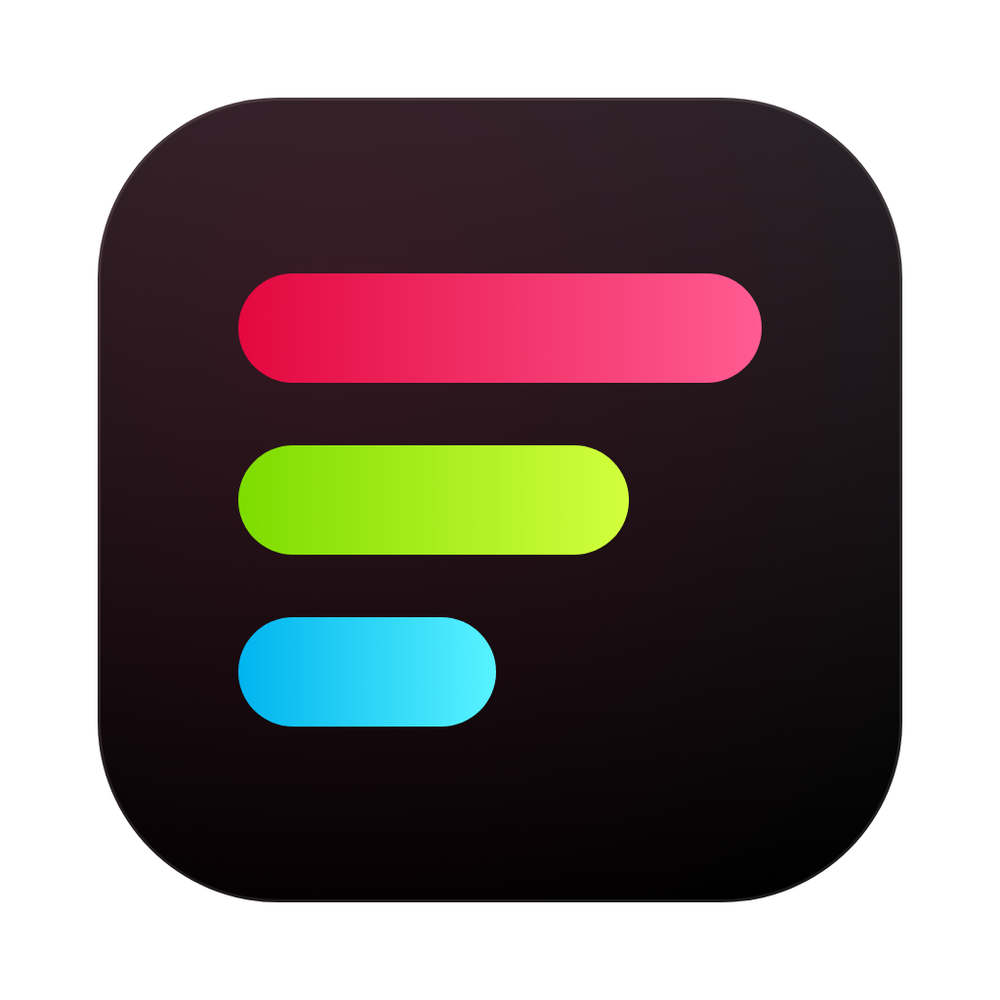
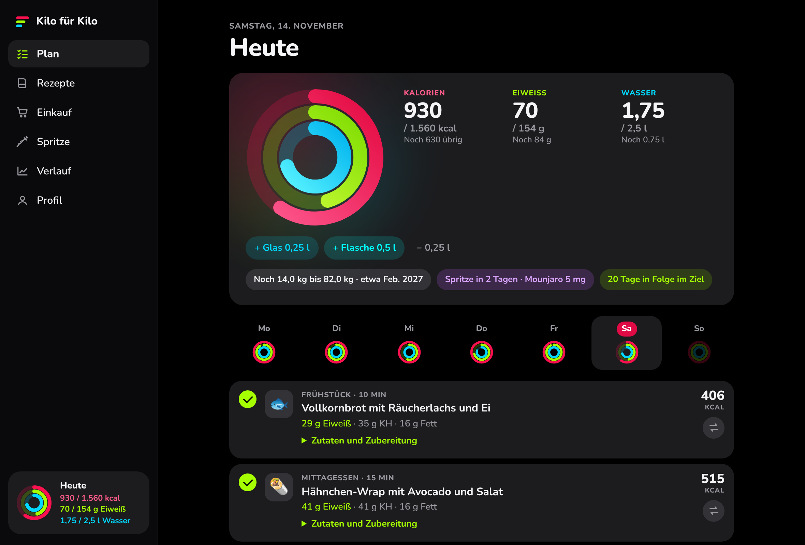
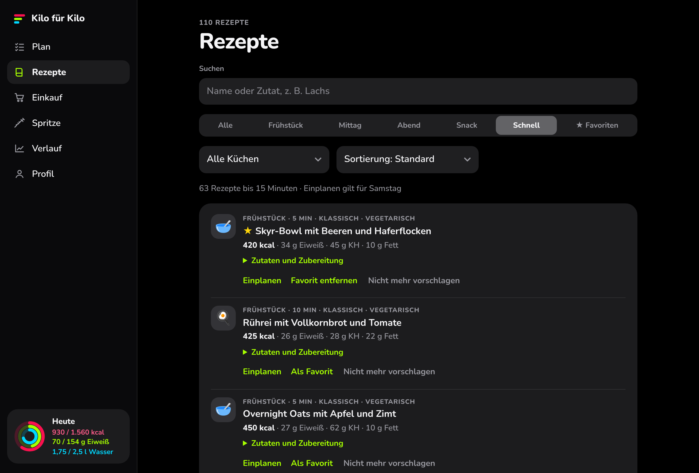
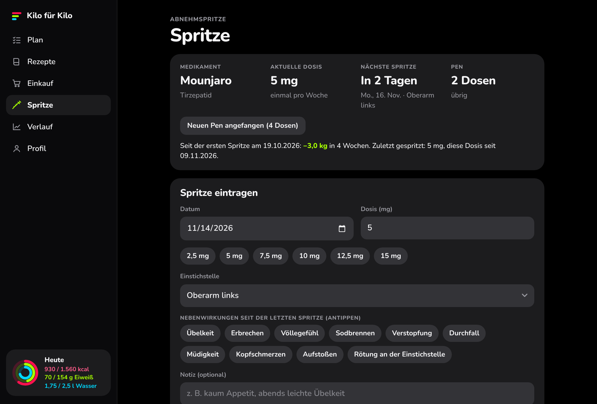
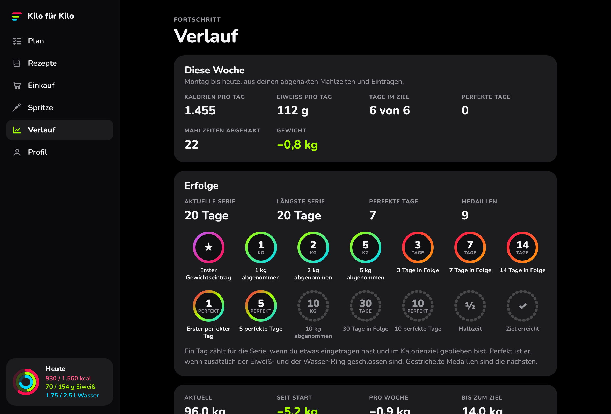

<p align="center"></p>
<h1 align="center">Kilo für Kilo</h1>
<p align="center"><b>Kilo für Kilo. Ring für Ring.</b><br>Der Ernährungsplan für den Mac: Kalorien, Eiweiß und Wasser auf einen Blick.</p>
<p align="center"><a href="https://github.com/Melo-Labs/Kilo-fuer-Kilo/releases/latest"><b>Für Mac laden</b></a> · <a href="INSTALLATION.md">Installation in drei Schritten</a></p>



Kostenlos, ohne Konto, ab macOS 11. Deine Daten bleiben auf deinem Mac. Alle Bilder zeigen Beispieldaten.

## Drei Ringe sagen dir, wo du heute stehst

| Kalorien | Eiweiß | Wasser |
|---|---|---|
| Dein Tagesziel aus Gewicht, Größe, Alter und Tempo. Der Ring zeigt, wie viel heute noch geht. | Hält satt und schützt die Muskeln. Schließt du den Ring, feiert die App mit. | Ein Tipp pro Glas, Ziel 2,5 Liter. |

## Was drin ist

**110 Rezepte, die in deinen Plan passen.** Die App stellt die Woche zusammen und rechnet jede Portion auf dein Kalorienziel um. 63 Gerichte sind in höchstens 15 Minuten fertig. Favoriten kommen öfter, Ungeliebtes nie wieder, und die Einkaufsliste entsteht von selbst.



**Gemacht für das Abnehmen mit Spritze.** Für Wegovy, Ozempic, Mounjaro, Saxenda oder ein anderes Medikament: nächster Termin, Einstichstellen-Wechsel, Pen-Vorrat, Nebenwirkungen und Dosis-Verlauf.



**Sieh, dass es vorangeht.** Gewichtskurve mit Trendlinie und geschätztem Zieldatum, Medaillen für Kilos, Serien und perfekte Tage, Wochenrückblick und Körpermaße.



**Außerdem:** eigene Lebensmittel und Getränke mit Suche, Restaurant und Fast Food, Sport, Fastenfenster, sechs kleine Mahlzeiten statt vier, Lebensmittel ausschließen, Datensicherung und Updates direkt aus der App.

## Gut zu wissen

- Die App ist ein privates Projekt und kein Medizinprodukt. Sie ersetzt keine ärztliche Beratung.
- Kalorien und Nährwerte sind Richtwerte, die Rezeptangaben geschätzt.
- Die App plant nie unter 1.500 kcal am Tag für Männer und 1.200 kcal für Frauen.
- Dosis und Steigerung deines Medikaments legt deine Ärztin oder dein Arzt fest.

---

# Für Bastler

Die ganze App steckt in `index.html`. Die Mac-App ist eine schlanke Hülle darum (`macos/`). Rezepte lädt die App bei jedem Start aus `recipes.json` in diesem Repository.

## Mac-App installieren

Die einfache Schritt-für-Schritt-Anleitung steht in [INSTALLATION.md](INSTALLATION.md).

**Variante A – selbst bauen (empfohlen, keine Sicherheitswarnung)**

```bash
xcode-select --install          # einmalig, falls noch nicht vorhanden
git clone https://github.com/Melo-Labs/Kilo-fuer-Kilo.git
cd Kilo-fuer-Kilo
./macos/build.sh install        # baut die App und legt sie in /Applications
```

**Variante B – fertige App herunterladen**

GitHub baut die App bei jeder Änderung automatisch und legt sie unter *Releases* → *Kilo für Kilo (aktuelle Version)* als `Kilo-fuer-Kilo.dmg` ab. Öffnen und die App in den Programme-Ordner ziehen.
Die App ist nicht von Apple notarisiert. Beim ersten Start deshalb: *Systemeinstellungen → Datenschutz & Sicherheit → „Dennoch öffnen“*.

## Neue Rezepte hinzufügen

`recipes.json` direkt auf GitHub bearbeiten und speichern. Die App holt die Datei beim nächsten Start (oder über „Rezepte aktualisieren“ ganz unten) – eine Neuinstallation ist nicht nötig. GitHub liefert Änderungen mit bis zu fünf Minuten Verzögerung aus. Das Repository muss dafür **öffentlich** sein.

Ein Rezept gehört in eine der vier Listen `fruehstueck`, `mittagessen`, `abendessen`, `snack`:

```json
{
  "id": "l10",
  "name": "Hähnchen-Curry mit Reis",
  "vegetarisch": false,
  "kcal": 540,
  "eiweiss": 44,
  "kohlenhydrate": 58,
  "fett": 12,
  "minuten": 25,
  "kueche": "Asiatisch",
  "symbol": "🍛",
  "zutaten": [
    ["Hähnchenbrust", 150, "g", "P"],
    ["Reis (roh)", 60, "g", "K"],
    ["Kokosmilch light", 100, "ml", "S"]
  ],
  "zubereitung": "Hähnchen anbraten, Kokosmilch und Currypaste zugeben, 10 Minuten köcheln. Mit Reis servieren."
}
```

- `id` muss eindeutig sein. Wer eine `id` ändert oder löscht, entfernt das Rezept aus bestehenden Plänen.
- Nährwerte gelten für die angegebene Portion; die App skaliert Mengen auf das Kalorienziel.
- Zutat: `[Name, Menge, Einheit, Kategorie]` – Einheit `g`, `ml` oder `Stk`; Kategorie `G` Gemüse & Obst, `P` Fleisch & Fisch, `M` Milchprodukte & Eier, `K` Getreide, Brot & Hülsenfrüchte, `S` Vorrat.
- Gleiche Zutaten immer gleich schreiben, damit die Einkaufsliste sie zusammenfasst.
- `minuten` ist die Zubereitungszeit; Rezepte bis 15 Minuten erscheinen im Filter „Schnell“.
- `kueche` und `symbol` sind freiwillig. Erlaubte Küchen: Klassisch, Italienisch, Asiatisch, Mexikanisch, Mediterran, Orientalisch. Fehlt eine Angabe, leitet die App Küche und Symbol aus dem Namen ab.
- Fehlerhafte Einträge überspringt die App. Ist die Datei kein gültiges JSON, bleibt der letzte funktionierende Stand aktiv.

## App-Updates

Jeder Push auf `main` baut die App neu und legt `Kilo-fuer-Kilo.dmg` und `version.json` im Release *latest* ab. Die Build-Nummer ist die Nummer des GitHub-Laufs. Die installierte App vergleicht ihre eigene Build-Nummer mit `version.json` und bietet unter *Profil → App und Updates* die Installation an: Sie lädt die `.dmg`, kopiert die neue App an ihren Platz und startet neu.

Voraussetzung: Die App liegt in einem Ordner mit Schreibrechten (normalerweise *Programme*) und wurde nicht direkt aus *Downloads* gestartet.

## Die App selbst ändern

Änderungen an `index.html` oder `macos/` brauchen einen neuen Build (Variante A erneut ausführen oder neues Release laden). Die in `index.html` eingebetteten Rezepte sind nur der Ausgangsstand für den ersten Start ohne Internet.
